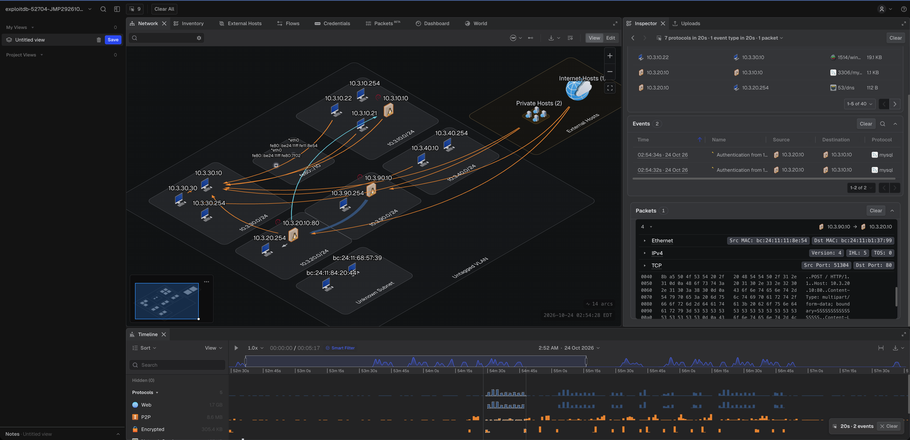

# PHP2Shell PCAPs

Packet captures from the php2shell vulnerability lab, recorded at multiple
tap points for detection engineering and traffic analysis.

*[Teleseer](https://go.teleseer.com) capture of the [`exploitdb-52704/`](exploitdb-52704/) kill-chain attack in the Ludus range*

**For authorized security research and educational purposes only.**
Do not use these captures or the associated exploit code against systems
you do not own or have explicit written permission to test.

## Vulnerabilities

### CVE-2026-109618

- **Advisory:** [GHSA-w8hw-w9fx-j79w](https://github.com/php/php-src/security/advisories/GHSA-w8hw-w9fx-j79w)
- **CVSS:** 9.2 (Critical)
- **Description:** Out-of-memory condition in PHP's `session.upload_progress`
  handler causes `longjmp()` to leave the Zend engine state invalid,
  resulting in arbitrary code execution. Affects PHP 5.4.0 through 8.5.11.
  Fixed in 8.2.35 / 8.3.36 / 8.4.27 / 8.5.12.

### CVE-2026-109619

- **Advisory:** [GHSA-6wmf-4rv5-p3rp](https://github.com/php/php-src/security/advisories/GHSA-6wmf-4rv5-p3rp)
- **CVSS:** 9.2 (Critical)
- **Description:** Stale global state persists across PHP-FPM worker requests,
  enabling a use-after-free in the session deserializer. An attacker can
  trigger `__destruct()` on a deserialized object during request startup
  via a session decode failure, achieving pre-authentication RCE. Affects
  PHP 5.4.0 through 8.5.11. Fixed in 8.2.35 / 8.3.36 / 8.4.27 / 8.5.12.

**Patch:** [Commit 3584a98](https://github.com/php/php-src/commit/3584a98bda)
(300 files changed across the Zend engine).

## Captures

| Directory | Description |
|-----------|-------------|
| [`exploitdb-52704/`](exploitdb-52704/) | Full Ludus range kill-chain capture with EDB 52704 (RCE, DB credential theft, `INTO OUTFILE` pivot, crown-jewel readback), plus an 18 s carve of the RCE landing |
| [`goldrak_php2shell-poc/`](goldrak_php2shell-poc/) | Baseline + all three RCE chains (A, A-prime, C, E), captured at both the Docker bridge (inside) and host loopback (outside) |

## Tools

These captures were analyzed with two tools that I consider
indispensable for network security work:

- **[Wireshark](https://www.wireshark.org/)** - protocol dissection and
  pcap inspection. The `tshark` CLI is the fast path for scripting
  verification (see `goldrak_php2shell-poc/README.md` for the exact
  filters used).
- **[Teleseer](https://go.teleseer.com)** by Cyberspatial - network
  visibility, host inventory, and packet inspection from the cloud.
  Loaded the pcap as a project, confirmed the two-host topology, and
  inspected the Chain A payload in the TCP stream without leaving the
  browser.

## Contributing

See [CONTRIBUTING.md](CONTRIBUTING.md) for PCAP size limits, sanitization
checklist, and review process.

## Disclaimer

All content in this repository is for authorized security testing and
educational purposes only. The vulnerabilities described here affect
production PHP installations. If you operate PHP services, apply the
patched versions listed above. 

## License

MIT (inherited from upstream).
